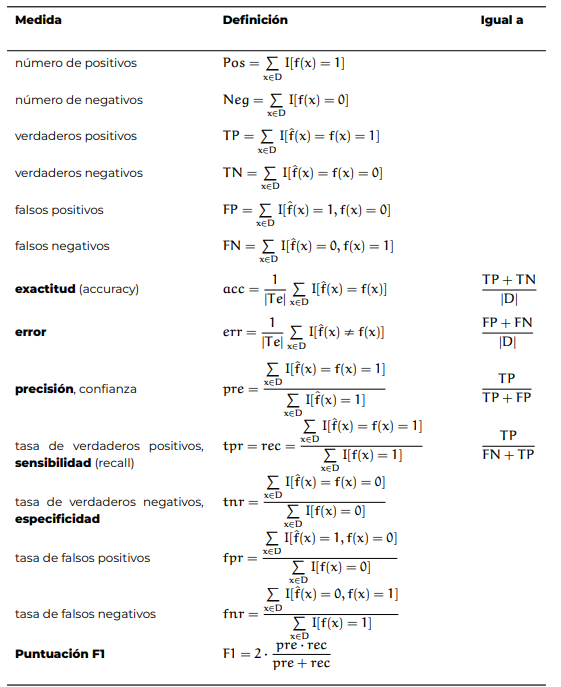
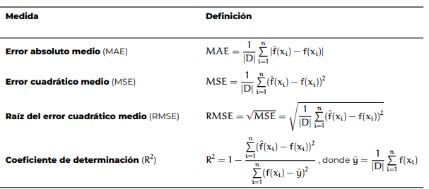

# Clase 5
- El modelo de clasificición más simple es la de la clasificación binaria

## Matriz de confusión
- Es apropiada para un modelo de clasificación
- Ejemplo en la página 7 del cuaderno
- En función del contexto nos podemos permitir algunos falsos positivos o falsos negativos.
    - Utilizamos una **tabla de contigencia** para determinar eso
---
## Tabla de contigencia
- 

- Se va a utilizar 4 métricas, exactitud, precisión, sensibilidad, especificidad
- Exactitud
    - La precisión es igual a lo real, siempre nos queda entre 0 y 1
- El error es lo opuesto a la exactitud en cuanto se equivoca
    - El error es 1 - la exactitud
    - Vamos a querer exactitudes cercanas a 1 y errores cercanos a 0
- Precisión
    - TP / TP + FP
    - Es la proporción de instancias clasificadas como positivas que son realmente positivas. Se prioriza cuando el costo de un Falso Positivo es alto
    - Un ejemplo claro es un filtro de correo spam en un entorno corporativo. Aquí, clasificar un correo importante (legítimo) como spam (Falso Positivo) es grave, pues podría perderse información crítica. Por ello, se prefiere que el modelo sea muy conservador: solo debe marcar como spam si está totalmente seguro, incluso si eso significa dejar pasar algunos correos basura a la bandeja de entrada (baja sensibilidad).
- Sensibilidad
    - TP / FN + TP
    - Proporción de instancias positivas que fueron correctamente identificadas. Se prioriza cuando el costo de un Falso Negativo es alto.
    - El mejor ejemplo es el diagnóstico médico de una enfermedad grave y contagiosa. El objetivo es detectar a todos los individuos enfermos. Es preferible alarmar a un paciente sano para realizarle más pruebas (Falso Positivo) que enviar a casa a un paciente enfermo diciéndole que está sano (Falso Negativo), ya que esto tendría consecuencias fatales.
## Puntación F1 o F1 score
- F1 = `2 x (pre x rec) / pre + rec`
- Nos ayuda a combinar la precisión y la sensibilidad
---
## Curva ROC(Receiver Operating Characteristic)
- Cuándo tengo un modelo en el que utilizo un umbral, debemos analizar la curva ROC
- Es la representación gráfica de un par de números(fpr, tpr) -> están en la tabla de contigencia
- fpr va en el eje de las x
- tpr va a estar en el eje de las y
- En medida que vamos generando diferentes umbrales vamos a ir generando la curva ROC
- Mientras la curva este más pegada al eje de las Y mi modelo es bueno
- Un modelo perfecto va a ser aquel que cubra la mayor cantidad de área(1)
- Mientrás más área que cubra la curva, mejor será mi modelo
- A eso se le llama AUC(Área bajo la curva| Area Under the Curve)
    - Si[0.97, 1.00] Excelente
    - Si[0.90, 0.97] Muy bueno
    - Si[0.75, 0.90] Bueno
    - Si[0.6, 0.75] Regular
    - Si[0.50, 0.60] Malo -> Es el peor valor posible
## Modelos de regresión
- Asumimos que los datos son continuos
- La realidad y la predicción las podemos operar
- |D| -> número de datos
- **Error absoluto medio**
    - Se interpreta en función a la distrubición de los datos
    - Con este error podemos determinar el error porcentual
- **Error cuadrático medio**
    - Es mejor que el error absoluto medio
    - Le elevamos al cuadrado en comparación a el error absoluto medio
    - Penaliza los errores grandes, es decir si el valor real era 10 y predijo 20, el error es de 10 puntos, 10^2 = 100
    - Ignora los errores pequeños pero amplifica los grandes
- **Raíz del error cuadrático medio**
    - Saca la raíz a los errores del error cuadrático medio
    - Saca la raíz después de sacar el promedio
    - Es un error interpretativo
        - Nos ayuda a interpretar los valores dados por el error cuadrático medio  
- **Coeficiente de determinación**
    - Medida estadística que utiliza regresión lineal para ver que tan bien se ajusta un modelo estadístico a los datos reales.
    - Indica el porcentaje de la variabilidad de la variable dependiente que puede ser explicado por la variable independiente
    - Siempre se encuentra entre [0 y 1]
    - $R^2 = 0$ (o 0%): El modelo no explica nada de la variabilidad de los datos. La línea de regresión no aporta mejor información que simplemente usar la media de los datos.
    - $R^2 = 1$ (o 100%): El modelo explica el 100% de la variabilidad. Todos los puntos de datos caen exactamente sobre la línea de regresión (ajuste perfecto).
    - El problema de añadir variables: En la regresión múltiple (con más de una variable independiente), el valor de $R^2$ nunca disminuye al agregar más variables, incluso si no tienen relación real con el problema. Esto puede dar una falsa sensación de mejora.
    - La solución ($R^2$ ajustado): Para evitar el engaño de añadir variables innecesarias, los estadísticos suelen utilizar el $R^2$ ajustado, el cual penaliza la inclusión de variables que no aportan un valor predictivo real al modelo.

- [Notebook de regresión](https://colab.research.google.com/github/andres-merino/AprendizajeAutomaticoInicial-05-N0105/blob/main/2-Notebooks/05-1-Evaluacion-de-Modelos-Regresion.ipynb#scrollTo=XpY1I13g5vFL)
---
## Métricas de modelos de agrupamiento
- También se le conoce como clustering y son parte del aprendizaje no supervisado
- Los datos vienen con etiquetas definidas por lo que se dividen las métricas en dos grupos: **internos** e **externas**
1. Métricas de evaluación interna:
   - Evalua que tan bien formados están los modelos de agrupamiento basándose en las características intrínsecas de los datos(distancia, cohesión y separación)
   - **Coeficiente de Silueta (Silhouette Score):** Mide qué tan similar es un objeto a su propio modelo de agrupamiento en comparación con otros modelos de agrupamiento.
   - Varía entre -1 y 1.
   - Un valor cercano a 1 indica que los modelos de agrupamiento están bien separados y definidos. Un valor cercano a 0 indica que los modelos se solapan, y valores negativos significan que los puntos pueden haber sido asignados al modelo de agrupamiento incorrecto.
   - **Índice de Davies-Bouldin:** Mide la "similitud" promedio entre cada modelo y su modelo más cercano.
     - Cuanto menor sea el valor, mejor (un valor de 0 indica la separación perfecta). Significa que los modelos son compactos y están muy alejados entre sí.
   - **Índice de Calinski-Harabasz (Varianza Ratio Criterion):** Evalúa la relación entre la dispersión entre los modelos y la dispersión dentro de los mismos.
     - Cuanto mayor sea el valor, mejor, ya que indica que los modelos están densamente agrupados y bien separados.
2. Métricas de Evaluación Externa
- Se utilizan cuando sí disponemos de etiquetas reales para comparar el resultado de nuestro algoritmo de agrupamiento con la clasificación "correcta" que ya conocemos.
- **Índice de Rand Ajustado (ARI - Adjusted Rand Index):** Mide la similitud entre dos asignaciones de modelos (la predicha y la real), corrigiendo el azar.
    - Varía de -1 a 1. Un valor de 1 representa un acuerdo perfecto entre los modelos y las etiquetas reales, mientras que los valores cercanos a 0 o negativos indican asignaciones aleatorias o peores que el azar.
- **Información Mutua Normalizada (NMI - Normalized Mutual Information):** Basada en la teoría de la información, mide cuánta información comparten los modelos predichos con las etiquetas reales.
  - Varía entre 0 y 1, donde 1 indica un acuerdo absoluto.
- **Homogeneidad, Completitud y V-Measure:**
    - Homogeneidad: Cada modelo contiene únicamente miembros de una sola clase.
    - Completitud: Todos los miembros de una clase dada se asignan al mismo modelo.
    - V-Measure: La media armónica entre ambos.
---
## Materiales de referencia
- [Resumen clase 05](https://andres-merino.github.io/AprendizajeAutomaticoInicial-05-N0105/2-Resumenes/Resumen05.pdf)
- [Clase 05](https://andres-merino.github.io/AprendizajeAutomaticoInicial-05-N0105/2-Clases/Clase05-1.pdf)
- [Notebook revisado en clase](https://github.com/andres-merino/AprendizajeAutomaticoInicial-05-N0105/blob/main/2-Notebooks/05-1-Evaluacion-de-Modelos-Clasificacion.ipynb)
- Revisar como hacer evaluación de modelos de clasificación con más de dos categorías